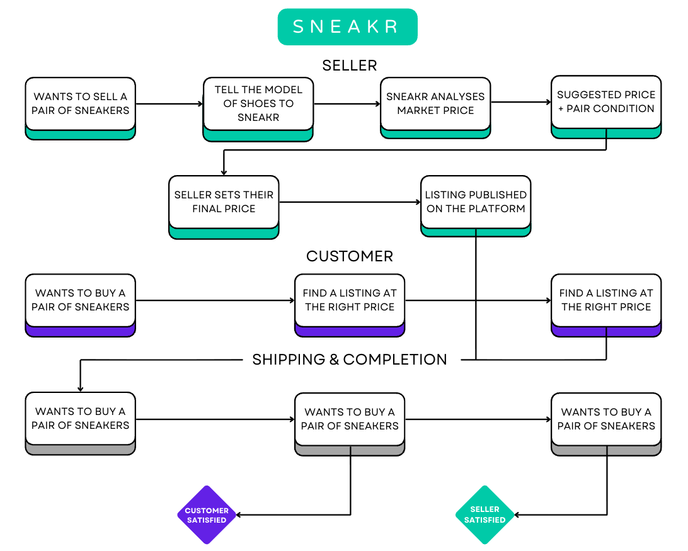

# 👟 SneakR

## 📈 Business

### 👨🏼 Personas

Our target customers are those who want to resell their shoes at the best price and adjust their resale price based on the wear and condition of the shoes. Whether they are knowledgeable about shoes or not, our chatbot is there to help our customers resell their shoes.

### 💯 Pain Points

Reselling shoes is easy with many websites these days. But a chatbot that can assign a value to a pair of shoes based on wear and condition would make reselling them simpler and fairer. Many people don't know what price to sell their shoes for, whether they have been worn or not.

### 🎯 Chatbot objectives

Our chatbot, SneakR, makes it easy for all retailers to sell their shoes at fair and reasonable prices. SneakR uses the retail price of the shoes chosen by the customer as a starting point and recommends a price that reflects the shoes' condition by asking various questions about wear and tear. SneakR is a chatbot that advises on the right price to help you sell your shoes as easily as possible at the best price.

### 🔗 Value Chain

## ⚖️ Ethical Impact Assessment

#### ELIZA Effect

Users may over-trust the chatbot's price suggestions, treating them as expert human advice rather than data-driven estimates. SneakR must clearly communicate its algorithmic nature at every interaction and frame suggestions as market-based ranges, not verdicts.

#### User Dependency

Frequent users may stop developing their own pricing instincts. To counter this, each suggestion should include a brief explanation of the reasoning — so users learn from the tool rather than just rely on it.

#### Chatbot Psychosis

Some users may anthropomorphise SneakR, becoming emotionally attached to its suggestions or, conversely, rejecting them entirely. The interface should use neutral, factual language and avoid any human-like persona.

#### Privacy

The chatbot collects data on owned models, selling habits, and condition descriptions — all potentially sensitive. SneakR must comply with GDPR: explicit consent, data minimisation, and a clear, accessible privacy policy at every step.

#### GDPR

SneakR only collects data strictly necessary for the service to function (model, size, condition of the pair). All collection requires explicit user consent, in compliance with European GDPR regulation.

#### Data anonymisation

Data used to train and improve the pricing model is systematically anonymised and aggregated. No individually identifiable data should be reconstructable from the training datasets.

## 💹 KPIs & ROI — SneakR

### 📊 Resolution rate

SneakR targets a price suggestion delivered in under 2 minutes from the start of the conversation. This keeps the user experience fluid and ensures sellers can list their pair without friction.

### ⏱️ Response time

Each chatbot response is delivered in under 5 seconds. This threshold maintains a natural conversational flow and prevents drop-off during the pricing interaction.

### 📈 Profitability model

The company applies a 3% platform fee on every transaction with a minimum of 3$ — the buyer pays 3% above the seller's listed price (excluding shipping). For a pair listed at $100, the buyer pays $103, with the $3 going directly to the company's revenue.

## 💵 ROI — SneakR

### 🏭 Company situation

The platform processes 500,000 sales per month before the chatbot is integrated, at an average resale price of $200. SneakR applies a 3% commission on every transaction, meaning $6 per sale on average.

### 📊 Situation before SneakR

With 500,000 monthly sales at $200 and a 3% commission, the platform's monthly revenue amounts to $3,000,000, or $36,000,000 per year.

### 📊 Situation after SneakR

By helping sellers set fairer and more competitive prices, the chatbot generates an estimated 15% increase in transaction volume, bringing monthly sales to 575,000. Monthly revenue then rises to $3,450,000, or $41,400,000 per year.

### 💵 Gain generated by SneakR

The gap between the two scenarios represents a net gain of $450,000 per month, or $5,400,000 in additional revenue per year — driven entirely by the increase in transaction volume enabled by the chatbot. This gain is fully attributable to the improved pricing quality that SneakR provides, making listings more attractive and accelerating sales.

### 📖 Summary

| Indicator       | Without SneakR | With SneakR  |
| --------------- | -------------- | ------------ |
| Sales / month   | 500,000        | 575,000      |
| Monthly revenue | $3,000,000     | $3,450,000   |
| Annual revenue  | $36,000,000    | $41,400,000  |
| Annual gain     | —              | + $5,400,000 |
